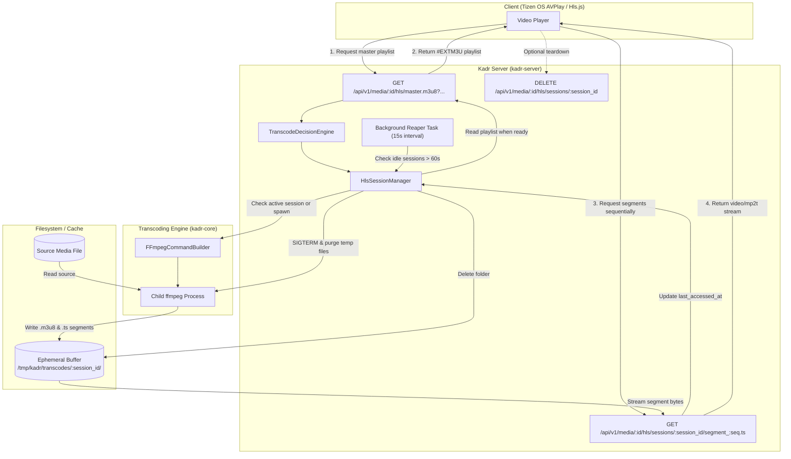

# HLS Transcoding & Universal Fallback Streaming Design Specification

## Overview
This specification details the architecture, on-demand transcoding engine, HLS packaging pipeline, session lifecycle management, and API routes for providing universal media playback on Samsung Smart TVs (Tizen OS) and other web/client players encountering unsupported audio/video codecs or container formats.

---

## 1. Background & Motivation

* **Context & Problem**:
  * Kadr currently serves media exclusively via direct-play HTTP 206 Byte-Range streaming (`stream_media_item`).
  * Smart TV platforms—specifically Samsung TVs running Tizen OS—have notable codec omissions:
    1. **Audio**: Modern Samsung TVs completely lack hardware and software decoders for DTS, DTS-HD, and Dolby TrueHD. When a direct stream containing these tracks is played, playback either fails completely or plays video in total silence.
    2. **Containers**: Native HTML5 `<video>` and AVPlay players on Tizen frequently reject or mis-index `.mkv` and `.avi` containers.
    3. **Video Profiles**: Older or budget Tizen models lack decoders for AV1, HEVC 10-bit (Main 10), or ultra-high bitrates.
* **Goals**:
  * Provide seamless HTTP Live Streaming (HLS) fallback when direct-play is unsupported by the client.
  * Implement **Smart Stream Copy**: when only the audio codec or container is unsupported (e.g., H.264 video with DTS audio in an MKV file), copy the video stream (`-c:v copy`) and only transcode the audio (`-c:a aac`), keeping server CPU usage near 0% and enabling instant playback startup.
  * Support full video transcoding (software CPU via `libx264` default, with configurable `vaapi`/`nvenc` hooks) when video re-encoding or downscaling is strictly required.
  * Provide an ephemeral **HLS Session Manager** that handles background `ffmpeg` processes, disk buffering, deduplication, and an automatic reaper for idle sessions.
  * Ensure zero-native-C build dependencies for Kadr by wrapping `ffmpeg` via standard asynchronous child processes (`tokio::process::Command`).

---

## 2. Architecture & Data Flow



---

## 3. Transcode Decision Engine & FFmpeg Pipeline

### 3.1 Decision Matrix (Smart Copy vs. Full Transcode)
The server inspects the media item's technical metadata stored in SQLite (or probes dynamically if technical info is missing) against requested target parameters:

| Scenario | Input Media | Target Parameters | Action Taken | CPU Impact |
| :--- | :--- | :--- | :--- | :--- |
| **Audio-only incompatibility** | Video: H.264 (1080p)<br/>Audio: DTS / TrueHD | `video_codec=h264`<br/>`audio_codec=aac` | **Smart Stream Copy**:<br/>`-c:v copy -c:a aac -b:a 192k` | **Near 0%** ($100\times$ real-time speed) |
| **Container-only incompatibility** | Container: MKV<br/>Video: H.264, Audio: AAC | `video_codec=h264`<br/>`audio_codec=aac` | **Pure Remux**:<br/>`-c:v copy -c:a copy` | **0%** (Remuxing container only) |
| **Video codec incompatibility** | Video: HEVC 10-bit / AV1<br/>Audio: AAC | `video_codec=h264`<br/>`audio_codec=aac` | **Full Transcode**:<br/>`-c:v libx264 -preset veryfast -crf 23`<br/>`-c:a copy` | CPU / GPU encode load |
| **Downscaling required** | Video: 4K (2160p)<br/>Audio: AAC | `max_height=1080` | **Transcode + Scale**:<br/>`-vf "scale=-2:1080" -c:v libx264`<br/>`-c:a copy` | CPU / GPU encode load |

### 3.2 FFmpeg Command Construction
The command builder produces safe, isolated arguments for execution:

```bash
ffmpeg \
  -hide_banner \
  -loglevel error \
  -ss <start_time> \
  -i <source_media_path> \
  -map 0:v:0 \
  -map 0:a:<audio_track_index> \
  <video_encoder_flags> \
  <audio_encoder_flags> \
  -sn \
  -f hls \
  -hls_time 4 \
  -hls_playlist_type event \
  -hls_flags independent_segments \
  -hls_segment_filename "<temp_dir>/segment_%04d.ts" \
  "<temp_dir>/playlist.m3u8"
```

1. **Independent Segments**: `-hls_flags independent_segments` guarantees that every 4-second `.ts` segment begins with an IDR keyframe, preventing seek failures and visual artifacts on Tizen AVPlay.
2. **Audio Selection**: Maps the selected audio track index (defaulting to the first audio stream if unspecified).
3. **Subtitles**: `-sn` disables embedded subtitle streams in the video multiplexer; Kadr's existing WebVTT sidecar service (`stream_webvtt`) delivers subtitles out-of-band for native player overlay.
4. **Hardware Acceleration**:
   - Software: `-c:v libx264 -preset veryfast -crf 23 -pix_fmt yuv420p`
   - VAAPI (if configured): `-vaapi_device /dev/dri/renderD128 -vf "format=nv12,hwupload" -c:v h264_vaapi`
   - NVENC (if configured): `-c:v h264_nvenc -preset p4 -cq 23`

---

## 4. API Endpoints Specification

### 4.1 Master Playlist Request
`GET /api/v1/media/{item_id}/hls/master.m3u8`

* **Query Parameters**:
  * `video_codec`: Optional string (`"h264"`, `"hevc"`, default `"h264"`).
  * `audio_codec`: Optional string (`"aac"`, `"ac3"`, `"eac3"`, default `"aac"`).
  * `max_height`: Optional integer (`1080`, `720`, `480`).
  * `max_bitrate`: Optional integer (kbps).
  * `audio_track`: Optional integer stream index (default `0`).
  * `start_time`: Optional float seek position in seconds (default `0.0`).
* **Headers**: Standard Bearer Token or `token` query param; reuses `UnlockedLibraries` validation.
* **Response**:
  * `Status: 200 OK`
  * `Content-Type: application/vnd.apple.mpegurl`
  * Body: Returns the `#EXTM3U` playlist containing URIs to the media segments for the generated session.

### 4.2 Segment Delivery
`GET /api/v1/media/{item_id}/hls/sessions/{session_id}/segment_{seq}.ts`

* **Path Parameters**:
  * `item_id`: `i64` media identifier.
  * `session_id`: `Uuid` string identifying the active transcode session.
  * `seq`: `u32` sequence index of the segment.
* **Behavior**:
  * Validates session existence and verifies that `session.media_id == item_id`.
  * Touches `session.last_accessed_at = Instant::now()`.
  * If the segment file is currently being written by `ffmpeg`, awaits file completion with a 10-second timeout.
  * Streams segment contents via `tokio_util::io::ReaderStream` in bounded 64 KB chunks.
* **Response**:
  * `Status: 200 OK`
  * `Content-Type: video/mp2t`
  * `Cache-Control: public, max-age=3600`

### 4.3 Session Teardown
`DELETE /api/v1/media/{item_id}/hls/sessions/{session_id}`

* **Behavior**: Immediately signals the child `ffmpeg` process to terminate and enqueues temp directory removal.
* **Response**: `Status: 204 No Content`.

---

## 5. HLS Session Lifecycle & Concurrency Management

### 5.1 In-Memory Session Manager
`HlsSessionManager` maintains active sessions behind an `Arc<RwLock<HashMap<String, Arc<TranscodeSession>>>>`:

```rust
pub struct TranscodeSession {
    pub session_id: String,
    pub media_id: i64,
    pub temp_dir: PathBuf,
    pub is_full_video_transcode: bool,
    pub last_accessed_at: Arc<AtomicU64>,
    pub child_process: Arc<tokio::sync::Mutex<Option<tokio::process::Child>>>,
    pub created_at: Instant,
}
```

### 5.2 Concurrency Throttling
* Configurable in `kadr.toml`:
  ```toml
  [transcoding]
  enabled = true
  ffmpeg_path = "ffmpeg"
  max_concurrent_transcodes = 2
  inactivity_timeout_secs = 60
  temp_dir = "/tmp/kadr/transcodes"
  hwaccel = "none" # "none" | "vaapi" | "nvenc"
  ```
* **Resource Fairness**:
  * Video transcode jobs (`is_full_video_transcode = true`) are gated by `max_concurrent_transcodes`. Exceeding this limit returns `HTTP 503 Service Unavailable` (`TRANSCODE_CAPACITY_EXCEEDED`).
  * Pure remuxes and audio-only transcode jobs (`-c:v copy`) bypass this limit because their CPU footprint is negligible.

### 5.3 Inactivity Reaper Task
* Spawns on server startup.
* Runs on a 15-second timer (`tokio::time::interval`).
* Inspects all active sessions:
  * If `current_timestamp - last_accessed_at > inactivity_timeout_secs`:
    1. Sends `SIGTERM` to the `Child` process handle.
    2. Allows a 2-second grace period before sending `SIGKILL` if still running.
    3. Asynchronously removes `<temp_dir>` from disk via `tokio::fs::remove_dir_all`.
    4. Removes the session from the manager map.
* On server shutdown, the manager immediately sends `kill()` to all running child processes and sweeps `<temp_dir>`.

---

## 6. Security & Error Handling

1. **Path Traversal Protection**:
   * `session_id` must parse strictly as a valid UUID (`Uuid::parse_str`).
   * `seq` must parse strictly as a `u32`.
   * Segment files are strictly resolved inside `session.temp_dir.join(format!("segment_{:04}.ts", seq))`.
2. **Library Authorization**:
   * Private libraries locked with a PIN require `UnlockedLibraries` verification before the session is created or segments are served.
3. **Missing System Dependency**:
   * If `ffmpeg` is not found on PATH or executable, returns `HTTP 501 Not Implemented` with `{ "error": "FFMPEG_UNAVAILABLE" }`.
4. **Process Crash**:
   * If `ffmpeg` exits with a non-zero exit code while writing the first segment, captured stderr is logged and the client receives `HTTP 500 Internal Server Error` (`TRANSCODE_FAILED`).

---

## 7. Testing Strategy

1. **Unit Tests (`kadr-core`)**:
   * Test CLI arg construction: verify `-c:v copy` when video matches target; verify `libx264` and scale filters when target height is smaller than source height.
   * Test playlist parsing and segment path formatting.
2. **Unit Tests (`kadr-server`)**:
   * Test `HlsSessionManager` session registration, deduplication, and touch timestamp updates.
   * Test reaper logic: verify expired sessions trigger process abort and directory deletion.
   * Test concurrency limits: verify full-transcode gating returns 503 when saturated.
3. **Integration / E2E Tests (`tests/e2e_hls_transcoding_test.rs`)**:
   * Generate synthetic test video with ffmpeg (H.264 + synthetic audio).
   * Request `GET /api/v1/media/{id}/hls/master.m3u8` and assert HTTP 200 with `#EXTM3U` and `#EXT-X-VERSION`.
   * Request `segment_0000.ts` and assert HTTP 200 with `video/mp2t` headers and valid MPEG-TS sync bytes (`0x47`).
   * Send `DELETE /api/v1/media/{id}/hls/sessions/{session_id}` and assert cleanup of temp files.
